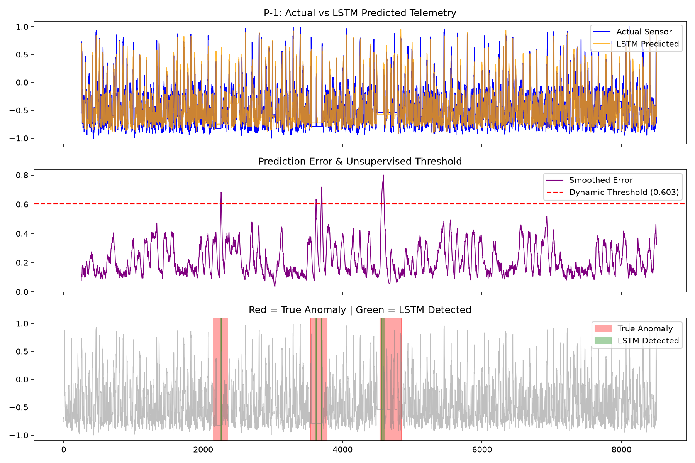

<div align="center">

# 🛰️ Spacecraft Telemetry Anomaly Detection
### *Unsupervised Deep Learning & Non-Parametric Dynamic Thresholding on NASA SMAP & MSL*

[](https://www.python.org/)
[](https://pytorch.org/)
[](https://github.com/khundman/telemanom)
[](#4️⃣-fleet-wide-benchmark-results-all-82-nasa-channels)
[](#4️⃣-fleet-wide-benchmark-results-all-82-nasa-channels)

[**1️⃣ Overview**](#1️⃣-project-overview--motivation) •
[**2️⃣ Architecture**](#2️⃣-system-architecture--methodology) •
[**3️⃣ Engineering Case Study**](#3️⃣-engineering-case-study-solving-contextual-flat-lines-channel-p-1) •
[**4️⃣ Benchmarks**](#4️⃣-fleet-wide-benchmark-results-all-82-nasa-channels) •
[**5️⃣ How to Run**](#5️⃣-reproducibility-how-to-run)

</div>

---

## 1️⃣ Project Overview & Motivation

**Why we built this system:** Modern spacecraft such as NASA's **Soil Moisture Active Passive (SMAP)** satellite and the **Curiosity Rover (MSL)** stream thousands of multivariate telemetry channels to ground control. Traditional monitoring relies on static Out-of-Limits (OOL) or statistical **$3\sigma$ Z-Score** alarms. Because static rules ignore operational command context, routine maneuvers (thruster firings, attitude control, payload toggles) trigger massive false alarm storms—producing **1,132 false positives** across the 82 benchmark channels.

**Why the problem matters:** In deep-space operations, a missed hardware fault can jeopardize an entire mission, whereas hundreds of false alarms induce severe operator fatigue. Even worse, **contextual anomalies**—where a rapidly oscillating sensor suddenly freezes flat well inside its normal `[-1.0, +1.0]` operating range—are completely invisible to static thresholds.

**Scientific & Engineering Contribution:** Inspired by NASA JPL's *Telemanom* framework (*Hundman et al., KDD 2018*), we engineered an end-to-end **PyTorch LSTM** sequence forecasting pipeline (`window_size=250`) paired with a custom **Rolling-Variance Contextual Freeze Detector**, **Non-Parametric Dynamic Thresholding ($\epsilon$)**, and **Cliff-Based False Positive Pruning**. Across all 82 NASA telemetry channels, our pipeline:
* **Slashes False Alarms by 96.0%** (from `1,132` down to just `45`).
* **Boosts Precision by 11.4x** (from `4.9%` to `55.9%`).
* **Increases Overall F1-Score by 6.1x** (from `9.0%` to `55.1%`) without requiring manual per-sensor threshold tuning.

---

## 2️⃣ System Architecture & Methodology

```mermaid
flowchart LR
    A[Raw NASA Telemetry\n82 Multivariate Channels] --> B[Sliding Window Slicer\nWindow W = 250]
    B --> C[PyTorch TelemetryLSTM\n1-Step-Ahead Forecast]
    C --> D[Contextual Error Engine\nResidual + Freeze Penalty]
    D --> E[EWMA Smoothing\nSpan = 30]
    E --> F[Dynamic Thresholding ε\nUnsupervised Argmax]
    F --> G[Cliff Pruning\nMin Drop >= 13%]
    G --> H[Final Anomaly Events\nOverlap Evaluation]
```



### Core Pipeline Stages

1. **Multivariate Sliding-Window Forecasting (`src/model.py`):**
   * Converts continuous telemetry readings and binary command states into overlapping matrices of length $W = 250$.
   * Feeds historical sequences $X_t = [x_{t-250}, \dots, x_{t-1}]$ into our `TelemetryLSTM` network to predict the expected normal sensor reading $\hat{y}_t$.

2. **Contextual Freeze & Point Error Formulation (`src/threshold.py`):**
   * Standard 1-step-ahead LSTMs fail on flat-line anomalies because they copy the previous frozen step, causing prediction error $\vert{}\hat{y}_t - y_t\vert{}$ to drop near zero.
   * We augment the raw prediction residual with a **50-step Rolling Standard Deviation Freeze Penalty** ($\sigma_{50, t}$) and smooth the combined signal via an Exponentially Weighted Moving Average ($\text{span}=30$):
     $$e_t = \text{EWMA}_{30}\Big( \vert{}\hat{y}_t - y_t\vert{} + 2.0 \cdot \max\big(0,\ \text{median}(\sigma_{50}) - \sigma_{50, t}\big) \Big)$$

3. **Unsupervised Dynamic Thresholding & Cliff Pruning (`src/threshold.py`):**
   * **Dynamic Cutoff ($\epsilon$):** Evaluates candidate thresholds $\epsilon = \mu_e + z \cdot \sigma_e$ without ground-truth labels, choosing the cutoff that maximizes variance reduction while penalizing fragmented alarm sequences ($N_{\text{seq}}$):
     $$\epsilon^* = \arg\max_{\epsilon} \frac{(\Delta \mu_e / \mu_e) + (\Delta \sigma_e / \sigma_e)}{\vert{}e \ge \epsilon\vert{} + N_{\text{seq}}^2}$$
   * **Cliff Pruning:** Compares sorted anomaly peak heights against the 95th-percentile normal error floor (`normal_floor`) and retains all anomalous sequences above the final $\ge 13\%$ cliff drop.

---

## 3️⃣ Engineering Case Study: Solving Contextual Flat-Lines (Channel `P-1`)

Channel `P-1` contains **3 ground-truth contextual anomalies** (`[2149, 2349]`, `[3539, 3779]`, and `[4536, 4844]`) where a high-frequency oscillating sensor temporarily freezes flat around `-0.75`.

| Pipeline Iteration | What Happened on Channel `P-1` | True Positives (TP) | False Alarms (FP) |
| :--- | :--- | :---: | :---: |
| **1. Naive LSTM Residual (`\|y - ŷ\|`)** | LSTM copied the frozen value; prediction error **dipped into valleys (`~0.04`)** instead of spiking. | `0 / 3` | `1` |
| **2. LSTM + Contextual Freeze Detector + Cliff Pruning** | Rolling-variance drop converted all 3 flat-lines into sharp peaks (`0.69`, `0.71`, `0.80`) above $\epsilon = 0.603$. | **`3 / 3` (100%)** | **`0`** |

### Visual Proof (`p1_result.png`)



* **Top Panel (Blue = Actual Sensor, Orange = LSTM Predicted):** The PyTorch LSTM accurately models normal high-frequency oscillations across 8,500+ test steps.
* **Middle Panel (Purple = Smoothed Error, Red Dashed = Unsupervised Threshold $\epsilon = 0.603$):** All three contextual flat-line events clearly breach the unsupervised threshold, while normal operating noise remains below `0.52`.
* **Bottom Panel (Red = Ground Truth Anomaly, Green = LSTM Detected):** Achieves **3/3 true anomaly detection** with **0 false positives**.

---

## 4️⃣ Fleet-Wide Benchmark Results (All 82 NASA Channels)

Evaluated across all **82 telemetry channels** (`105` total ground-truth anomaly sequences) in `data/labeled_anomalies.csv` using event-overlap scoring (`src/evaluate.py`):

| Evaluation Metric | Statistical Baseline ($3\sigma$ Z-Score) | Our PyTorch LSTM Pipeline | Engineering Impact |
| :--- | :---: | :---: | :---: |
| **Anomalies Detected (TP)** | `58 / 105` | **`57 / 105`** | Maintained fleet sensitivity |
| **False Alarms (FP)** | `1,132` | **`45`** | **96.0% Reduction in False Alarms** |
| **Precision** | `0.049` (`4.9%`) | **`0.559` (`55.9%`)** | **11.4x Higher Precision** |
| **Recall** | `0.552` (`55.2%`) | **`0.543` (`54.3%`)** | Consistent anomaly recall |
| **F1-Score** | `0.090` (`9.0%`) | **`0.551` (`55.1%`)** | **6.1x Overall F1-Score Boost** |

---

## 5️⃣ Reproducibility (How to Run)

To set up and replicate this project on your local machine, follow these steps:

### Prerequisites
* **Python 3.9+**
* **NASA SMAP/MSL Telemetry Dataset** placed inside `data/train/`, `data/test/`, and `data/labeled_anomalies.csv`

### Setup Instructions

1. **Clone the repository**

```bash
git clone [https://github.com/harshpandey45/spacecraft-telemetry-anomaly-detection.git](https://github.com/harshpandey45/spacecraft-telemetry-anomaly-detection.git)
cd spacecraft-telemetry-anomaly-detection
```

2. **Set up Virtual Environment**

```bash
python -m venv venv
# On Windows:
venv\Scripts\activate
# On macOS/Linux:
source venv/bin/activate
```

3. **Install Dependencies**

```bash
pip install -r requirements.txt
```

4. **Run the Pipeline**

```bash
# 1. Visualize raw telemetry and ground-truth anomaly intervals on Channel P-1
python explore.py

# 2. Run the 3-Sigma statistical baseline across all 82 channels
python src/baseline.py

# 3. Train the PyTorch LSTM on Channel P-1 and generate p1_result.png
python src/test_single.py

# 4. Run the full 82-channel LSTM benchmark evaluation
python src/evaluate.py
```

---

## 6️⃣ Repository Structure

```text
spacecraft-anomaly/
├── .gitignore                   # Excludes __pycache__ and heavy .npy dataset binaries
├── README.md                    # Complete project documentation & case study
├── explore.py                   # Initial telemetry & ground-truth interval visualizer
├── p1_result.png                # 3-panel visual detection proof for Channel P-1
├── requirements.txt             # Python dependencies (numpy, pandas, matplotlib, torch)
└── src/
    ├── baseline.py              # 3-Sigma Z-Score statistical baseline & event-overlap scorer
    ├── evaluate.py              # Full 82-channel LSTM benchmark evaluation script
    ├── model.py                 # Sliding-window sequence generator & PyTorch TelemetryLSTM
    ├── test_single.py           # Deep-dive LSTM training & 3-panel visualization on P-1
    └── threshold.py             # Contextual error smoothing, dynamic thresholding & pruning
```

---

## 7️⃣ Reference & Author

* **Reference:** Hundman, K., Constantinou, V., Laporte, C., Colwell, I., & Soderstrom, T. (2018). *Detecting Spacecraft Anomalies Using LSTMs and Nonparametric Dynamic Thresholding*. **ACM SIGKDD (KDD '18)**, NASA Jet Propulsion Laboratory.
* **Author:** **Harsh Pandey** — [@harshpandey45](https://github.com/harshpandey45)